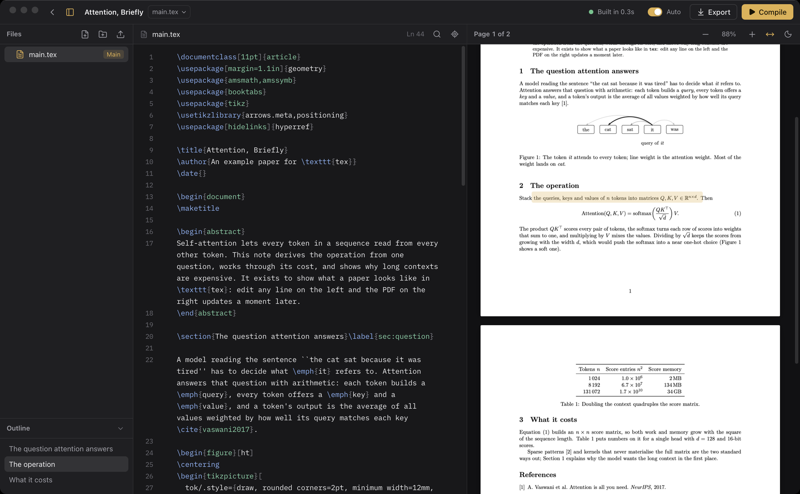
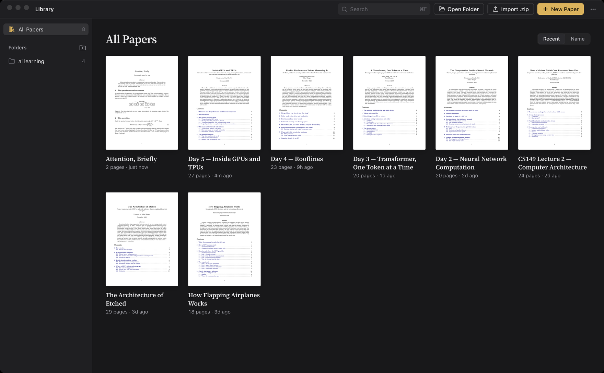

<h1 align="center">
  <br>
  tex
</h1>

<p align="center">
  <b>Write LaTeX on your Mac with a live PDF beside it.</b><br>
  A local, fast alternative to Overleaf: no account, no upload, your papers are plain folders.
</p>

<p align="center">
  <a href="https://github.com/rahul-bangre/tex/releases/latest"><b>Download for macOS (Apple Silicon)</b></a>
</p>



## Install

You need a Mac with Apple Silicon (M1 or newer) running macOS 12 or later.

1. **Install Tectonic**, the LaTeX engine tex uses. It downloads only the packages your papers
   need, so there's no 5 GB TeX distribution to install. In Terminal:

   ```sh
   brew install tectonic
   ```

   No Homebrew? Get it from [brew.sh](https://brew.sh), or see the
   [other ways to install Tectonic](https://tectonic-typesetting.github.io/book/latest/installation/).

2. **Download** `tex_<version>_aarch64.dmg` from the
   [latest release](https://github.com/rahul-bangre/tex/releases/latest), open it, and drag
   **tex** into **Applications**.

3. **Open it the first time.** tex isn't notarized by Apple yet, so macOS blocks the first launch.
   Open tex once and dismiss the warning, then go to **System Settings → Privacy & Security**,
   scroll down to *"tex" was blocked*, and click **Open Anyway**. You only do this once.
   (Or, in Terminal: `xattr -dr com.apple.quarantine /Applications/tex.app`.)

## Your first paper

* **Start fresh:** click **New Paper** (`⌘N`) and choose *Article* or *Blank*. Copied a whole
  `.tex` document? Choose *From Clipboard*.
* **Move from Overleaf:** in Overleaf open your project, choose **Menu → Download → Source**, then
  click **Import .zip** in tex, or drop the zip onto the window.
* **Open an existing folder:** **Open Folder** (`⌘O`) works with any folder that contains a
  `.tex` file. To try one, open [`examples/attention-briefly`](examples/attention-briefly) from
  this repository.

Start typing. With **Auto** on, the PDF updates about half a second after you pause.



## What you get

* **Live preview.** Each recompile takes about a second on a 25-page paper with TikZ figures,
  because tex reuses the previous build's references instead of running LaTeX three times.
* **Jump between source and PDF.** Press `⌘J` to see the current line in the PDF. Double-click
  the PDF to jump back to the source.
* **Errors where they happen.** Problems are underlined in the editor and listed in a panel;
  click one to go to its line. The last good PDF stays on screen while you fix things.
* **Autocomplete** for LaTeX commands, environments, `\ref` labels and `\cite` keys from your
  `.bib` files.
* **A library of papers.** Every paper shows its real first page. Group papers into folders in
  the sidebar and drag papers between them.
* **Plain files.** Papers live in `~/Documents/Papers` (change it from the `⋯` menu). Edit them
  in another editor, keep them in git, or let an AI assistant write them: tex reloads and
  recompiles whenever a file changes on disk. Build output never clutters your folders.
* **Export** (`⌘E`) saves the PDF wherever you want.
* Light and dark mode follow your system.

## Keyboard shortcuts

| Shortcut | Action |
|---|---|
| `⌘N` | New paper |
| `⌘↵` or `⌘S` | Compile (`⌘⇧↵` rebuilds from scratch) |
| `⌘E` | Export PDF |
| `⌘J` | Show the current line in the PDF |
| `⌘P` | Go to file |
| `⌘F` | Find and replace |
| `⌘B` | Show or hide the sidebar |
| `⌘⇧M` | Show or hide Problems |
| `⌘+`, `⌘−`, `⌘0` | Zoom the PDF, fit to width |

## Good to know

* **Engine.** Tectonic is based on XeTeX, while Overleaf defaults to pdfLaTeX. Almost every
  document compiles the same. If one doesn't, the cause is usually `inputenc`/`fontenc`
  settings written for pdfLaTeX.
* **Shell escape is off**, so packages that run external programs (such as `minted`) won't work.
* **BibTeX** works out of the box. `biblatex` with the `biber` backend hasn't been tested yet.
* **Intel Macs** aren't supported by the download yet. You can build from source instead.

## Build from source

You need [Rust](https://rustup.rs), [Node.js](https://nodejs.org) 20 or later, and Tectonic.

```sh
git clone https://github.com/rahul-bangre/tex.git
cd tex
npm install
npm run tauri dev                              # run in development
npm run tauri build -- --bundles app,dmg       # build tex.app and a .dmg
cd src-tauri && cargo test                     # run the Rust tests
```

tex is built with [Tauri](https://tauri.app) (Rust) and [Svelte](https://svelte.dev), with
[CodeMirror](https://codemirror.net) for editing and [pdf.js](https://mozilla.github.io/pdf.js/)
for the preview. [DESIGN.md](DESIGN.md) holds the visual rules every screen follows.
